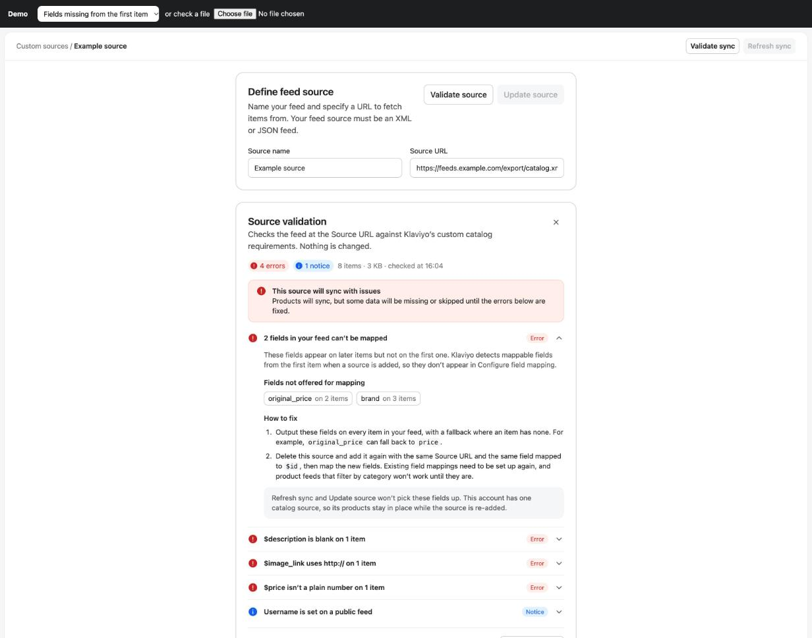
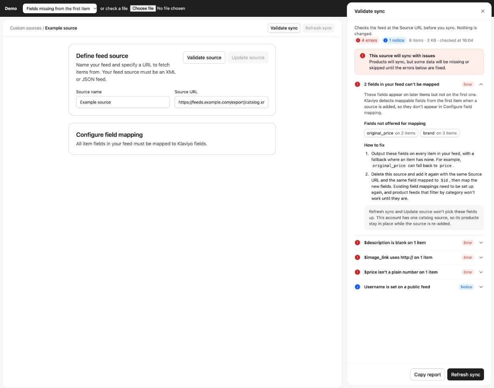

# Catalog feed validation

Checks a custom catalog feed against Klaviyo's requirements and shows what's wrong, and how to fix it, on the **Edit Catalog Source** page.

Today, when a custom catalog sync goes wrong, the account user usually sees a generic status ("Feed Inaccessible", "Sync Complete" with missing data, or a field that never appears in the mapping). This adds two buttons that read the feed and explain the problem in plain language:

| Validate source | Validate sync |
|---|---|
|  |  |
| Next to **Update source**. Opens an inline card under "Define feed source". | Next to **Refresh sync**. Opens a side panel docked beside the page, like the Composer panel. |

Both show the same results. The screenshots use the made-up example feed in `demo/samples.js`.

## How it fits together

```
Validate source / Validate sync clicked
        │
        ▼
Backend fetches the Source URL (the same fetch the sync makes)
        │  body, status, headers, size, timing
        ▼
validateCatalogFeed(response, context)        ← src/checks.js
        │  { verdict, summary, findings[] }
        ▼
Inline card or side panel                     ← src/panel.js (reference)
```

`src/checks.js` is pure: no network and no DOM. It runs unchanged in Node and the browser. The fetch belongs on the backend, not in the browser, for two reasons: browsers can't read most third-party feed URLs (CORS), and feeds can be 50 to 100 MB.

The checks are written in JavaScript. If the backend service is in another language, treat `src/checks.js` and `test/checks.test.js` as the specification: the tests pin down what each check reports, so a port can be checked against them.

## Input

```js
const result = validateCatalogFeed(response, context);
```

Every property is optional. A check whose input is missing doesn't run.

**`response`**, from the fetch:

| Property | Type | Used for |
|---|---|---|
| `body` | string | All content checks |
| `httpStatus` | number | 401, 403 and other error responses |
| `feedUrl` | string | The file-extension check |
| `redirected`, `finalUrl` | boolean, string | The redirect check |
| `byteSize` | number | Size limits |
| `responseTimeMs` | number | The slow-response check |
| `cacheControl` | string | Pass `''` when the header is absent. Leave it out if headers weren't collected. |
| `formatHint` | `'json'` or `'xml'` | Optional. Format is detected from the body otherwise. |
| `fetchError` | string | When the request failed outright |
| `requestedWithoutCredentials` | boolean | True if the fetch was made without the source's username and password |

**`context`**, from the account and source:

| Property | Type | Used for |
|---|---|---|
| `catalogSourceCount` | number | What deleting and re-adding this source does to its products |
| `accountItemLimit` | number | The real item limit. Without it, the default 25,000 is assumed. |
| `sourceHasCredentials` | boolean | Whether Username/Password are set on the source |

## Output

```js
{
  verdict: 'will_not_sync' | 'syncs_with_issues' | 'syncs_with_warnings' | 'ok',
  summary: { errors, warnings, notices },
  ok, format, itemCount, byteSize, fieldMap,
  findings: [ /* sorted: blocking first, then error, warning, notice */ ]
}
```

Each finding:

```js
{
  id: 'first_item_missing_fields',     // stable, for analytics and tests
  severity: 'error' | 'warning' | 'notice',
  blocking: false,                     // true: no products sync until this is fixed
  title: '5 fields in your feed can’t be mapped',
  description: 'These fields appear on later items but not on the first one…',
  fields: [{ name: 'original_price', count: 6758 }, …],   // or null
  items: [{ index: 96, id: 'ec6e…', value: '…' }, …],     // up to 5 examples, or null
  affectedCount: 61,                   // total items affected, or null
  fix: ['Output these fields on every item…', 'Delete this source and add it again…'],
  note: 'Refresh sync and Update source won’t pick these fields up…'      // or null
}
```

All text is written for the account user. In `fix` and `note`, text in `backticks` is a field name and renders as code. **Field names, IDs and values come from the customer's feed: render them as text, never as HTML.** `src/panel.js` uses `textContent` throughout.

## The checks

| Finding `id` | Severity | Blocking | Fires when |
|---|---|---|---|
| `fetch_failed` | error | yes | The request failed outright |
| `http_401` | error | yes | The feed asks for credentials |
| `http_403` | error | yes | The host refuses the request (usually a firewall or bot protection) |
| `s3_access_denied` | error | yes | Amazon S3 returns AccessDenied (403) |
| `http_error` | error | yes | Any other 4xx or 5xx |
| `redirected` | error | yes | The URL redirects before returning the feed |
| `feed_too_large` | error | yes | Over 100 MB |
| `empty_response` | error | yes | The body is empty |
| `html_page` | error | yes | The URL returns a webpage instead of the feed |
| `wrapped_json` | error | yes | Valid JSON with stray characters around it (the item checks still run) |
| `xml_multiple_declarations` | error | yes | More than one `<?xml ?>` declaration |
| `xml_declaration_not_first` | error | yes | Something comes before the `<?xml ?>` declaration |
| `xml_unclosed_elements` | error | yes | The XML is incomplete (often a truncated export) |
| `xml_stray_closing_tags` | error | yes | Closing tags with no opening tag |
| `unreadable_feed` | error | yes | Neither JSON nor XML, or no repeated product element |
| `no_items` | error | yes | The feed parses but has no products |
| `required_fields_missing` | error | yes | No field matches `$id`, `$title`, `$description`, `$link` or `$image_link` |
| `first_item_missing_fields` | error | no | Fields on later items are missing from the first item, so they can't be mapped |
| `required_field_blank` | error | no | A required field is blank on some items |
| `duplicate_ids` | error | no | More than one item shares an `$id` (only the first syncs) |
| `link_not_url` | error | no | `$link` isn't a URL |
| `image_not_https` | error | no | `$image_link` uses http:// |
| `image_data_uri` | error | no | `$image_link` is an inline data: URI (syncs as a blank image) |
| `image_invalid` | error | no | `$image_link` isn't a full URL |
| `price_is_string` | error | no | JSON `$price` is a quoted string |
| `price_invalid` | error | no | `$price` has a currency symbol, code or other text |
| `inventory_invalid` | error | no | `$inventory_quantity` isn't a number |
| `over_item_limit` | error or warning | no | Over the account item limit (error when `accountItemLimit` is known, warning against the default) |
| `feed_large` | warning | no | Over the recommended 50 MB |
| `slow_response` | warning | no | Took longer than 15 seconds |
| `no_file_extension` | warning | no | The URL path has no .xml, .json or similar extension |
| `xml_nested_fields` | warning | no | Fields nested more than one level deep (dropped by the sync) |
| `empty_array` | warning | no | An empty list is sent for a mapped field (the old value is kept) |
| `placeholder_text` | warning | no | Values such as "n/a" in title, description or categories |
| `encoding_corrupted` | warning | no | UTF-8 text read with the wrong character set ("é" for "é") |
| `inventory_negative` | warning | no | Negative stock levels |
| `categories_comma_in_name` | warning | no | A category name appears to contain a comma |
| `categories_wrong_delimiter` | warning | no | Categories separated by ">" instead of commas |
| `all_prices_zero` | warning | no | Every price is 0 |
| `no_cache_control` | notice | no | No Cache-Control header (a CDN may serve stale copies) |
| `credentials_not_needed` | notice | no | Username/Password are set, but the feed loads without them |

Fields are matched by name after removing a leading `$` or `g:`, splitting camelCase and lowercasing. Common alternatives are recognised (for example `sku` for `$id` and `image_url` for `$image_link`); see `FIELD_ALIASES` in `src/checks.js`.

## Building the UI

`src/panel.js` and `src/panel.css` are a framework-free reference for the layout and behaviour. In the app, build it from the design-system components the page already uses:

| In the reference | Design-system component |
|---|---|
| Inline card (`createSourceCard`) | Card with `InternalCardHeader`, the same as "Define feed source" |
| Docked panel (`createSyncPanel`) | Drawer panel (`InternalDrawerHeader`, `InternalDrawerBody`, `InternalDrawerFooter`), docked like the Composer panel so the page narrows beside it |
| "4 errors", "1 notice" | `StatusBadge`, medium, negative / warning / info, with icon |
| "Error", "Warning", "Blocking" | `StatusBadge`, small, label only |
| Field chips with counts | `Tag`, with count |
| Loading bar | `ProgressBar`, info |
| Buttons | Secondary for Validate source, Validate sync, Copy report and Validate again; primary for Refresh sync |
| Colours | The existing tokens, such as `--color-background-negative-subtle-base` and `--color-border-subtle-base` |

Behaviour to keep:

- The first finding starts expanded, because it is the one to fix first.
- The verdict box sits above the list: red for `will_not_sync` and `syncs_with_issues`, orange for `syncs_with_warnings`, green for `ok`.
- "Copy report" copies `formatReport(result, { feedUrl })`, a plain-text version for pasting into a support conversation.
- Nothing on either panel changes the source. Refresh sync in the panel footer is the existing action.

## To confirm before shipping

These come from support research, not from the sync code. Check them against the real backend before release:

- **Limits:** 25,000 items per account by default, 50 MB recommended, 100 MB maximum, about 15 seconds before "Feed Inaccessible" becomes likely. They are in `limits` at the top of `src/checks.js`.
- **First-item detection:** mappable fields are read from the first item only, and only when a source is first added. Update and Refresh don't re-read them.
- **Deleting a source:** with another source still active, the deleted source's products are removed until the re-added source syncs them back. When it is the only source, they stay.
- **Redirects** are rejected, and a URL **without a file extension** can be refused.
- **Allowlisting:** the 403 fix tells users to allow the user agent `Klaviyo/1.0` (and `KlaviyoBot`). Confirm the current user agent strings.

## A product fix worth considering

The most common finding, `first_item_missing_fields`, only needs a delete and re-add because field detection runs once, on the first item, when a source is created. If **Update source** re-detected fields across more than one item, that finding's fix would drop to a single step, and the deletion risk would go away.

## Running it

```bash
npm test
```

Node 18 or later, with no dependencies.

To try the UI, serve the folder and open the demo page, which includes example feeds and a file picker for checking a local feed file:

```bash
python3 -m http.server 8000
```

Then open http://localhost:8000/demo/.

## Files

```
src/checks.js        The checks: validateCatalogFeed() and friends
src/panel.js         Reference UI: createSourceCard(), createSyncPanel(), formatReport()
src/panel.css        Reference styles, using the design tokens
demo/index.html      Demo page
demo/samples.js      Made-up example feeds, shared by the demo and the tests
test/checks.test.js  Tests (node:test)
docs/                Screenshots
```
